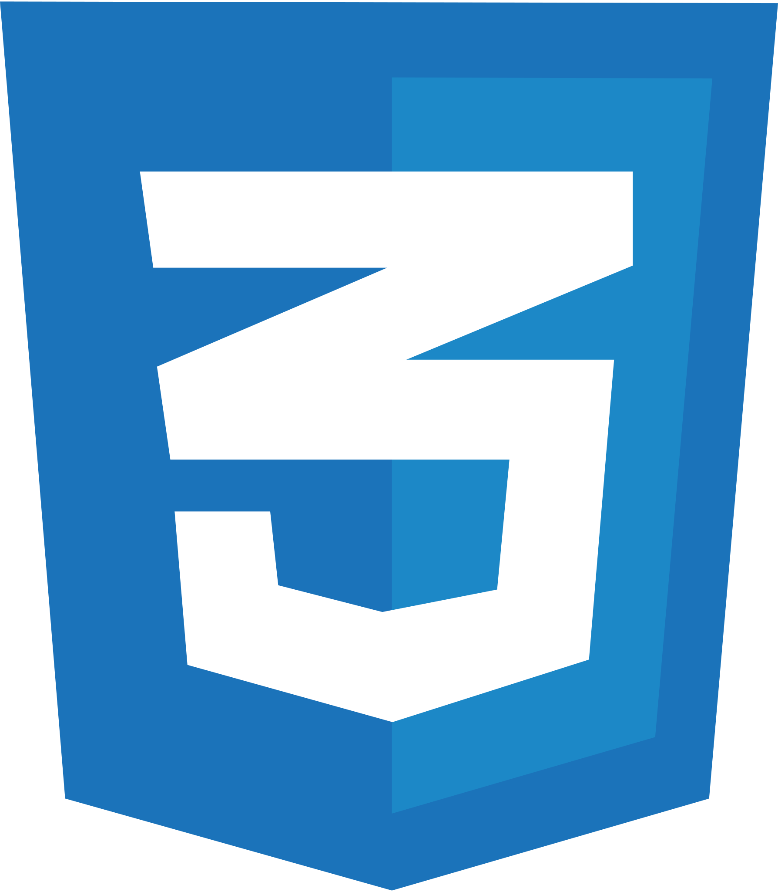
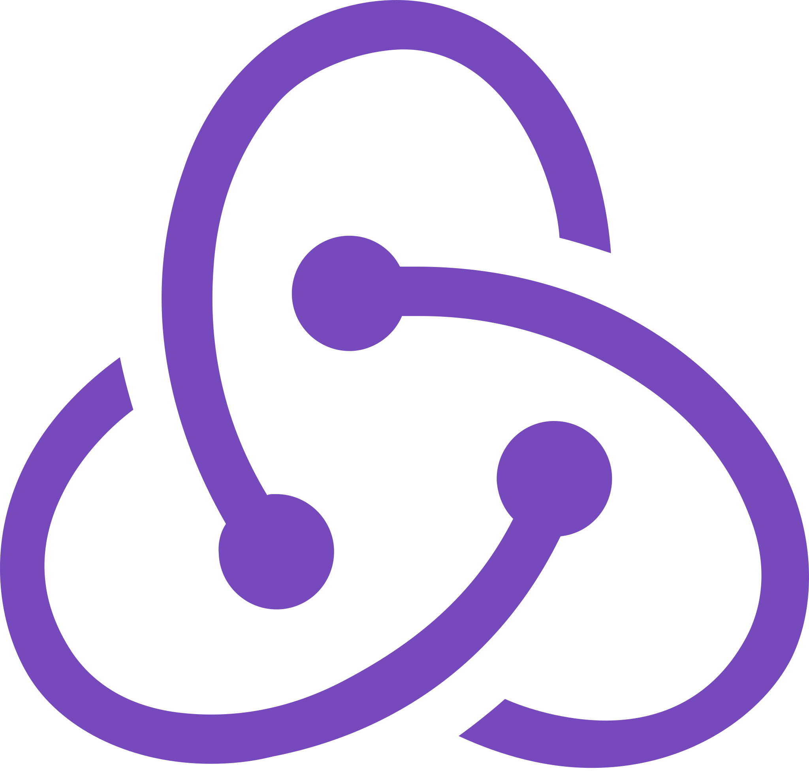
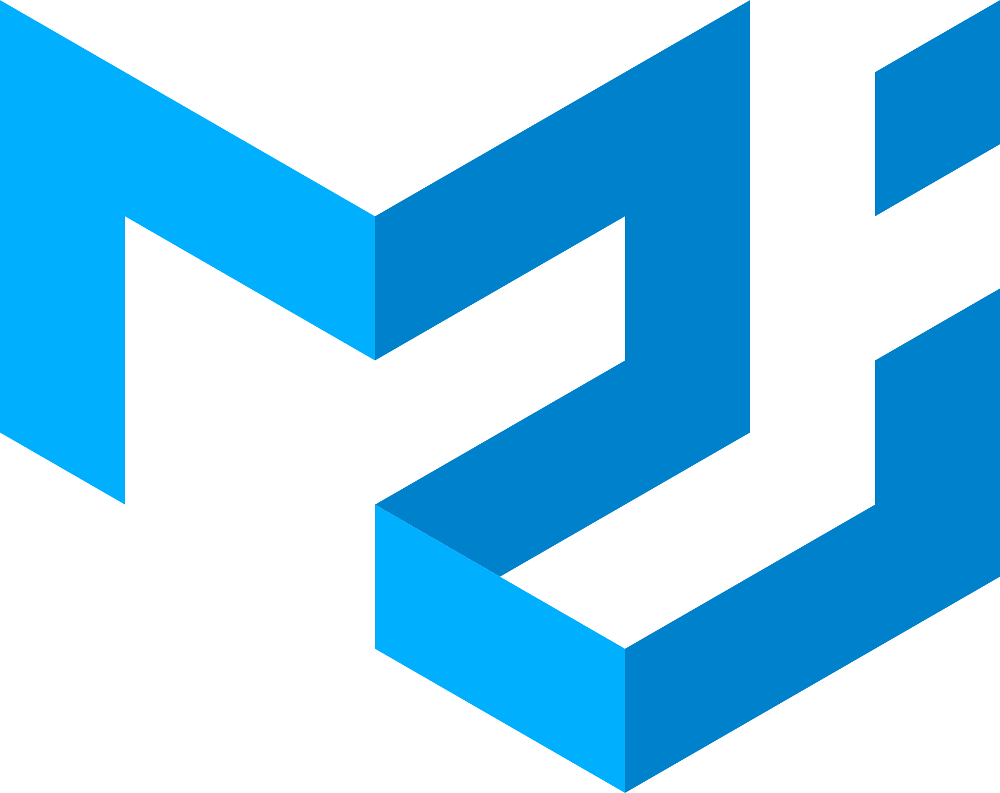
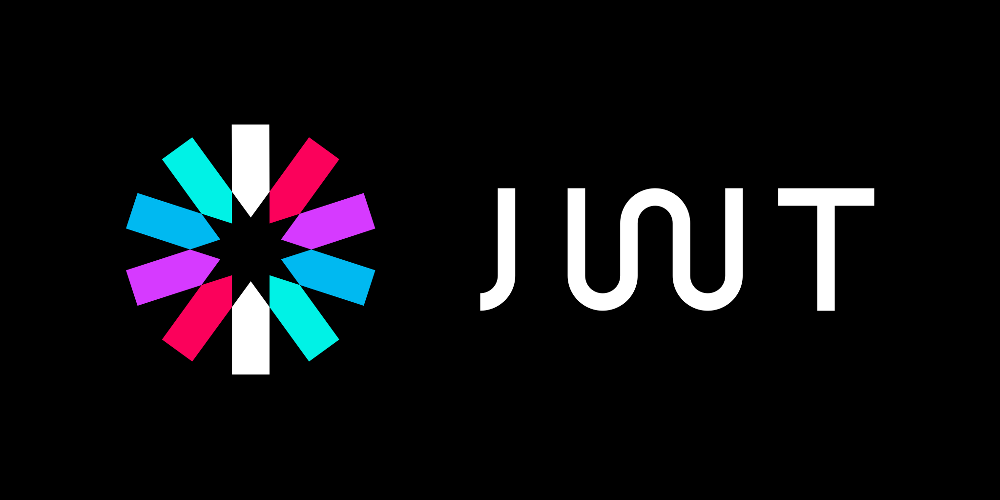
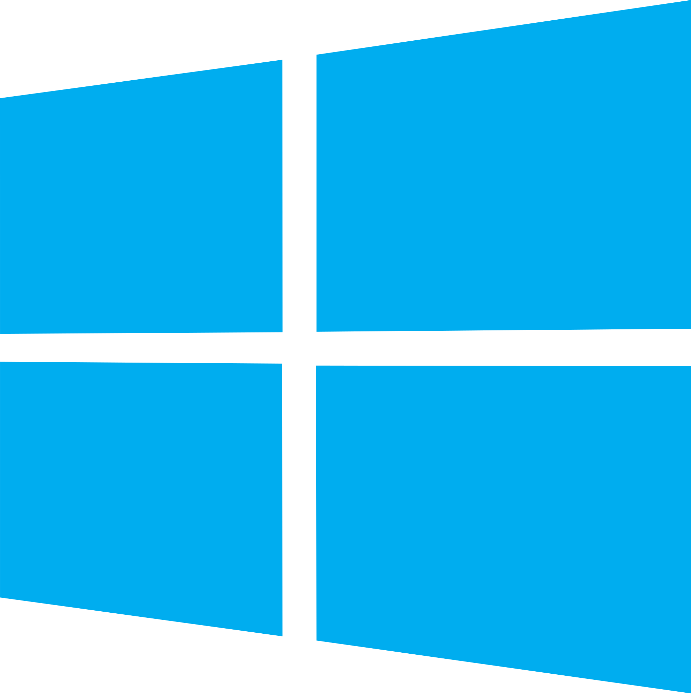
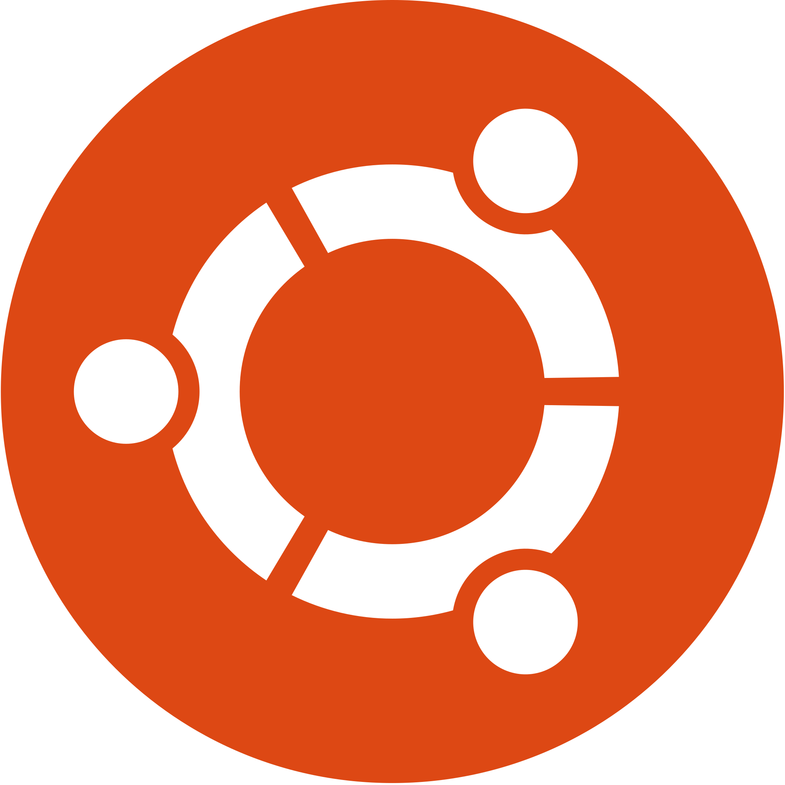

<!-- markdownlint-disable MD033 -->
<!-- markdownlint-disable MD041 -->

<h1 align="center">Hello , I'm Santosh 👋</h1>
<h3 align="center">I’m a MERN stack developer tuned into CyberSecurity — currently learning Linux, networking, and ethical hacking to bridge the gap between development and security. On a mission to master both sides of the digital battlefield.Passionate about continuous learning, knowledge sharing, and creating scalable, impactful applications.</h3>

  

  

  

<h1> ❄️ About Me</h1>

- 🌐 **MERN Stack Developer | Cybersecurity Explorer**
  
- 🧑🏻‍💻 **Crafting scalable web apps while mastering Linux, Networking & Ethical Hacking.**
  
- 🔒 **Active learner on HTB & TryHackMe, documenting each machine with real-world, easy-to-grasp breakdowns.**
  
- 📖 **Maintaining a growing library of notes**

- 🛡️ **Dual mindset: build like a dev, think like an attacker.**

- 📚 **Passionate about continuous learning and exploring new technologies**

- 🤝 **Always up for meaningful collabs, open-source contributions, and cyber talks.**
  
- 💡 **"Not just chasing the future — I’m reverse-engineering it."**
  
- 🐺 **Just getting started — let’s see where this path takes me.**

- 🎉 **Fun fact: My cat sniffs packets better than most firewalls!😸**

 

<h1 align="left">🔱 Languages and Tools</h1>

### Frontend Development

### UI/UX & Styling

### 3D & Visualization

### Backend Development

### Mobile Development

### Development Tools & Utilities

### Languages & Scripting

### Cloud & Hosting

### DevOps & CI/CD

### Operating Systems

### Cybersecurity

 
<h1>⚜️ My Github Stats</h1>

 

&nbsp;

 

 

